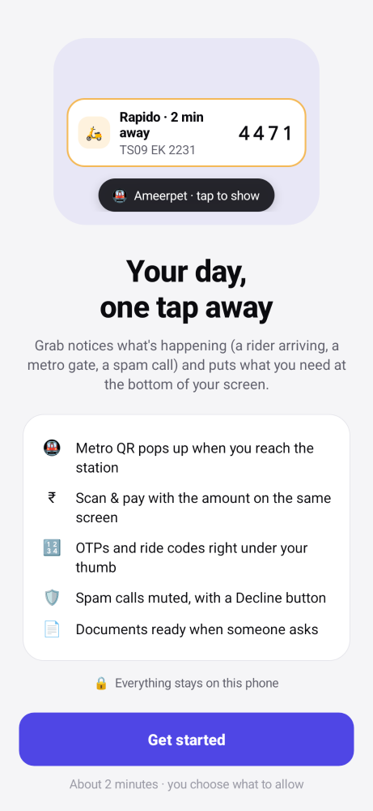
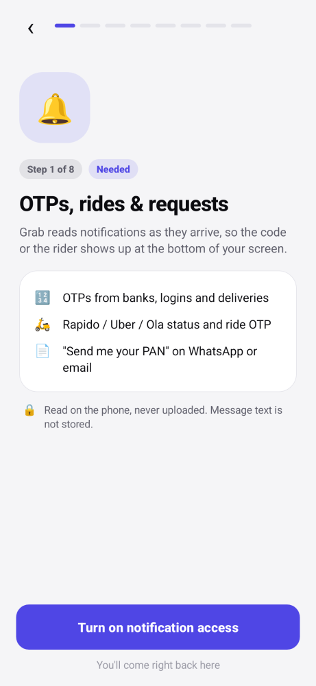
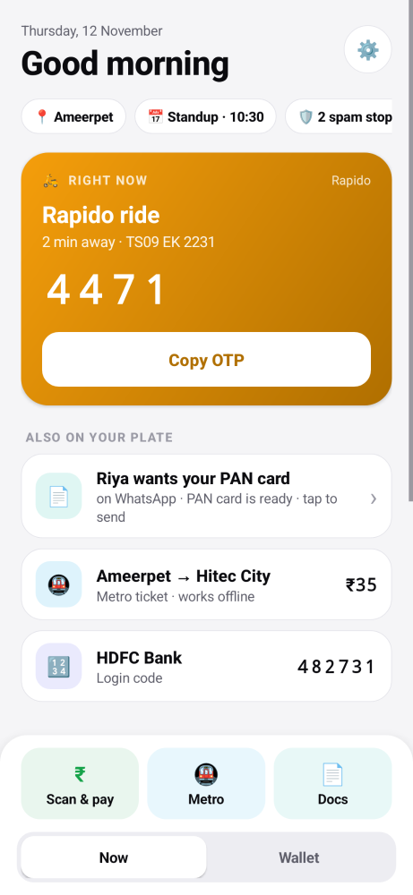
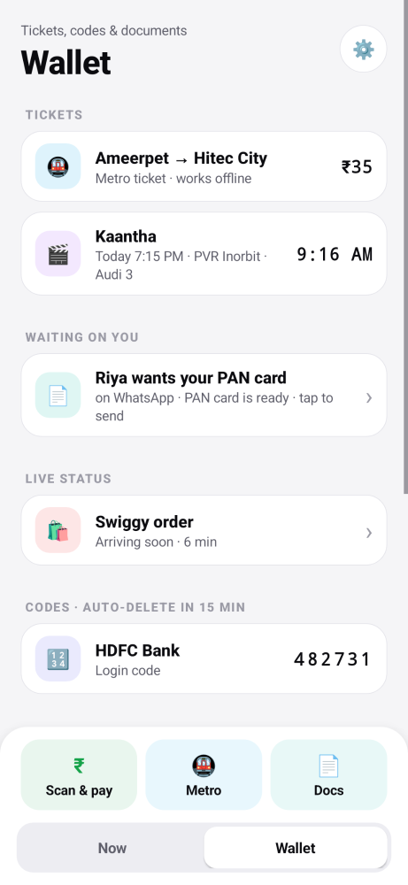
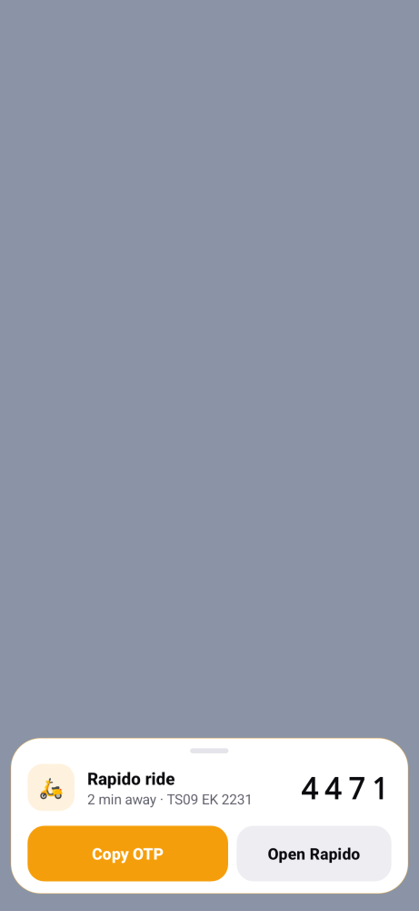
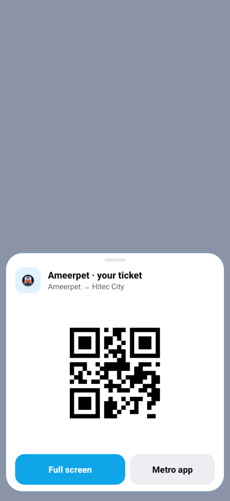
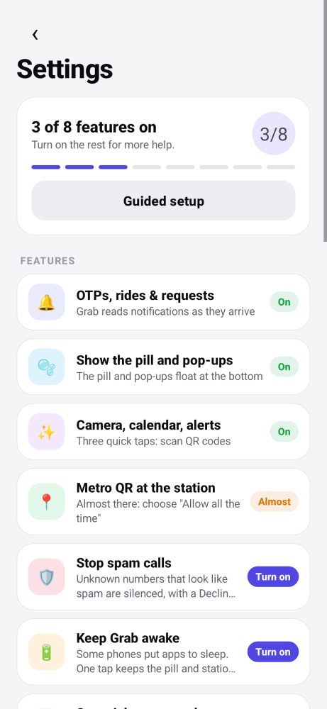
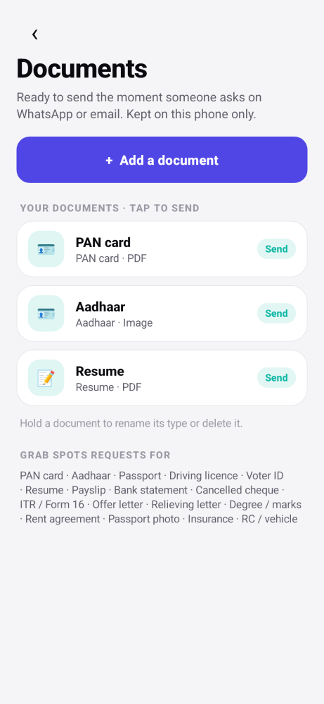
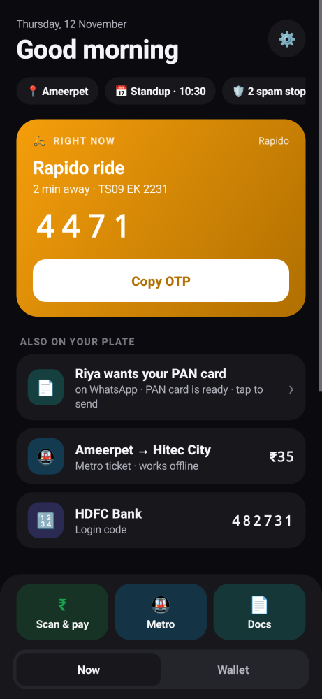
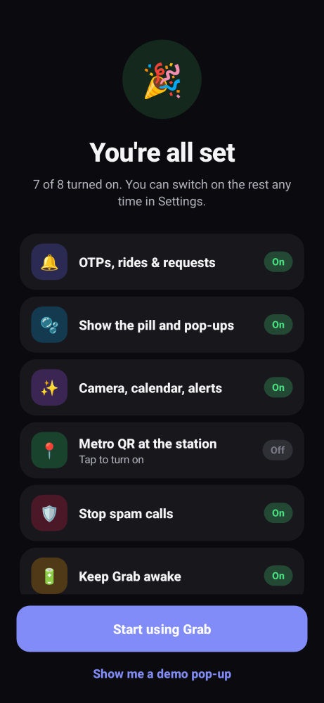

# Grab v0.4 (Android): a context assistant in your thumb zone

Grab watches what is happening on your phone (notifications, where you are, the time, incoming calls)
and puts the one thing you need **at the bottom of the screen**, so you stop jumping between apps and
reaching for the top of the screen.

| Moment | Before | With Grab |
|---|---|---|
| Metro gate | unlock → metro app → ticket → tap QR → brightness up (4–5 steps) | walk into the station → QR pops up at full brightness (0 taps) |
| Pay a shop | open UPI app → scan → type amount → PIN (4 screens) | hold the pill → camera + your usual amount on one screen → PIN in your UPI app |
| Rapido OTP | pull down notifications from the top → read → remember | pop-up at the bottom: "2 min away · 4 4 7 1" + Copy |
| Spam call | phone rings, you look, you decline | ringtone muted + pop-up: **Decline · Always block · It's OK** |
| "Send me your PAN" | open WhatsApp → attach → Files → find PAN → send | pop-up: **Send PAN card** → WhatsApp opens with it attached |
| Meeting in 2 min | open calendar → find event → find link | pop-up: **Join** |

Everything is processed **on the phone**. The only exception is the optional AI (off by default, see below).

## Screens

   

   

Dark mode:  

These are rendered from the real UI code on the build machine with [Paparazzi](https://github.com/cashapp/paparazzi)
(`ANDROID_HOME=… gradle recordPaparazziDebug`); every screen exists in light and dark under `app/src/test/snapshots/images/`.

## First run: guided setup
Grab opens with a short guided setup: one screen per permission, each saying **what it unlocks, why, and what Grab never does with it**.
- The button goes **straight to Grab's own switch** (notification access, display over apps), not a long list of apps.
- The screen **moves on by itself** as soon as the permission is granted, with a ✓.
- Camera + calendar + notifications are asked **together in one step**; spam screening asks for the call-screening role and the
  "decline calls" permission **back to back**; battery uses Android's **one-tap** "allow background use" dialog
  (plus an *Autostart* shortcut on Xiaomi / Oppo / Realme / OnePlus / Vivo / Huawei).
- Location asks twice in one step (while using → **all the time**), and the button text changes to tell you which to pick.
- **Android 13+ "Restricted setting"** (apps installed outside the Play Store): if notification access is blocked, the screen
  shows the 3-step fix with an *Open app info* button.
- Only notification access and display-over-apps are needed; everything else can be skipped and turned on later in
  **Settings → Features**, which uses the same flow and shows On / Almost / Turn on for each.

## The pieces

**Pill** (bottom of every screen)
- tap: the most urgent card (OTP, ride, ticket, a request) · **hold: Scan & pay** · **swipe up: quick panel** · swipe down: hide that card · drag sideways: move

**Pop-ups** slide up above the pill when the assistant thinks something needs you, then go away by themselves (or swipe down).

**Home screen**: two tabs, **Now** (ranked for this moment) and **Wallet** (tickets, documents, codes), with a bottom bar: **Scan & pay · Metro · Docs**.

## How it understands context

| Signal | What Grab does with it |
|---|---|
| Notifications | OTPs, ride and order status, tickets (`Parser.kt`); "send me your PAN / resume…" and "can you confirm?" in WhatsApp, Gmail, Outlook, Telegram, Slack, SMS (`Asks` in `Docs.kt`) |
| Where you are | geofences around places it knows (`Places.kt`). **Metro stations are learned by themselves:** open your metro ticket at a station once, and next time the QR pops up as you walk in. Spots near Home/Work are never learned as stations |
| Habits | every time you open a ticket, pay or send a document it counts (weekday/weekend × hour, slowly fading). At that hour, those things rank higher in the pill, the panel and the hub (`Habits.kt`). The hub shows what it has learned ("Metro ticket: usually around 8 AM on weekdays") |
| Incoming calls | as the phone's Caller-ID & spam app, Grab sees calls from numbers **not in your contacts** (`SpamScreener.kt`): your blocked numbers are rejected; 140-series telemarketing, spoofed caller ID, hidden and unexpected international numbers are silenced with a Decline pop-up |
| Calendar | one-tap Join 3 minutes before a meeting with a Meet/Zoom/Teams link |
| Clock | movie ticket pops up 25 minutes before the show; the pill re-ranks every minute |

`Assistant.kt` is the one place that decides what deserves a pop-up; `CardStore.score` decides what the pill shows.

## Payments: what is and isn't possible
Grab puts the camera and the amount on **one screen** and hands the payment to your UPI app with payee and amount filled
(the original QR is passed through untouched, so merchant QRs keep working). The UPI app you pick the first time is remembered.
**Grab can't approve the payment itself:** under NPCI rules only your bank's UPI app can authorise it, with your UPI PIN.
To use your **fingerprint** instead of the PIN, turn on biometric UPI (or UPI Lite for small payments) in your UPI app, if it offers it.

## Documents
Wallet → Documents (or the **Docs** button): add your PAN, Aadhaar, resume, payslips, etc. once. They're copied into app-private
storage (not the gallery). When someone asks for one, the pop-up sends it straight into the app they asked in (WhatsApp, Gmail…):
you pick the chat and press send. If it isn't in the vault yet, the pop-up says **Find it**: pick the file once and Grab sends it
and keeps it for next time.

## Optional AI (off by default)
Setup → *Optional AI*. With your own Anthropic API key, messages the local rules can't decide ("can you mail me the signed copy?")
are sent to Claude, one message at a time (sender name, app, text, with runs of 4+ digits masked), only when they look like a question or request.
Claude answers whether it's a document request or needs a reply. OTPs, rides, tickets, calls and locations are never sent.
The key is stored encrypted on the phone. The default model is `claude-opus-5-5` and can be changed in the same dialog.
Note: the SDK for this adds ~55 MB to the APK.

## Install
1. Build: push to GitHub → Actions → "Build APK" → download `grab-pill-apk` (or open in Android Studio → ▶ Run).
2. Install the APK and open Grab: the guided setup walks you through everything (about 2 minutes).
3. Optional: Settings → pick your **metro app** (opened at the station when no ticket is saved).

## Test in 5 minutes (Settings → Try it)
1. **🛵 Rider** → pop-up at the bottom with the OTP and Copy.
2. **📄 PAN request** → pop-up: *Find it* (first time) → pick a file → share sheet opens. Do it again: now it says *Send PAN card*.
3. **🚇 At metro** → metro QR pops up at full brightness.
4. **🛡 Spam call** → see the Decline / Block / It's OK layout.
5. Hold the pill → Scan & pay opens with the camera; point at any UPI QR.

## How it reads any app (no setup)
Grab doesn't keep a list of apps to support. Every notification is scored on what it says, and the best match becomes a card:
ride words + a number plate or ride OTP → **ride**; order / out for delivery / shipped → **delivery**; PNR, flight or train number,
gate, coach → **flight / train / bus**; show time, audi, metro → **ticket**; a 4–8 digit code → **OTP**. Promotions
("50% off your next ride") are ignored.
- **It learns each app.** Once an app has sent two ride (or delivery, or ticket) notifications, even its vaguer ones are read
  the same way (`AppMemory` in `AutoLearn.kt`). It also learns your metro app by itself.
- **QR codes inside notifications** (the big picture some apps attach) are read and saved as a crisp ticket.
- **Ticket screenshots save themselves** (optional step): screenshot a QR in any app and it's added, no sharing needed.
  Only new screenshots with a QR and ticket-like text are kept.
- **Optional AI** (off by default): notifications that look like an event but the rules can't read are sent to Claude
  (numbers masked) to be turned into a card.

To check a real notification, add it to `app/src/test/java/app/grab/pill/AnyAppTest.kt`; CI runs these tests on every push.

## Updates install themselves
Every push to `main` builds a signed APK and publishes it as a GitHub release (`build-<number>`). Grab checks a few times a
day; when there's a newer build:
- first time: a pop-up / Home banner → **Update** → Android asks once to confirm;
- after that, on Android 12+: Grab installed itself, so new versions install **silently** in the background.
Settings → *App updates* shows your version and has *Check now*.

One-time setup (repository owner): add two repository secrets so every build is signed with the same key
(Android only accepts an update signed like the installed app): `GRAB_KEYSTORE_B64` (the keystore, base64) and
`GRAB_KEYSTORE_PASS`. Without them CI still builds, but doesn't publish updates. Phones that have an APK signed with a
different key need to uninstall Grab once and install the first signed build; updates are automatic after that.

## Files
```
Assistant.kt     the decision maker: which moment deserves a pop-up, and its buttons (+ Live: exact "Open" targets)
PillService.kt   the pill (gestures) + pop-up overlay at the bottom, ticks every minute
Card.kt          Card model + CardStore (on-device file, expiry, context-aware ranking)
Habits.kt        Ctx (where you are now) + Habits (what you use when)
Places.kt        known places as geofences, self-learning metro stations, GeofenceReceiver
Docs.kt          DocVault (your documents) + Asks (detect "send me your X" and send it)
DocsActivity.kt  the vault screen; "Find it" flow
SpamScreener.kt  call screening + SpamRules
ScanPayActivity.kt  live camera + amount on one screen → your UPI app
Brain.kt         optional Claude classifier for unclear messages (off by default)
Parser.kt, Importer.kt, GrabNotificationListener.kt   notifications / screenshots / PDFs → cards
Design.kt        design system: light/dark palette, type, buttons, rows, chips, switches
Perms.kt         every permission: status, wording, shortest grant path (PermRequester)
Onboarding.kt    guided first-run setup
HubActivity.kt + HubUi.kt   Now · Wallet tabs + thumb bar     PillActivity.kt  quick panel (PanelUi)
CardActivity.kt  show a card at full brightness (CardUi)     SetupActivity.kt Settings (SettingsUi)
PopupUi.kt       look of the pop-up and the pill             test/ShotsTest.kt renders every screen to PNG
```

## Next (v0.4)
- Auto-import new screenshots that contain a ticket QR.
- "Leave by 6:38" for movies and meetings from travel time.
- Learn which chat a document usually goes to.
- Encrypted storage (Room + SQLCipher).
